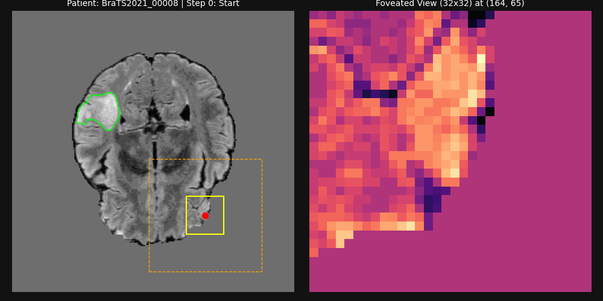
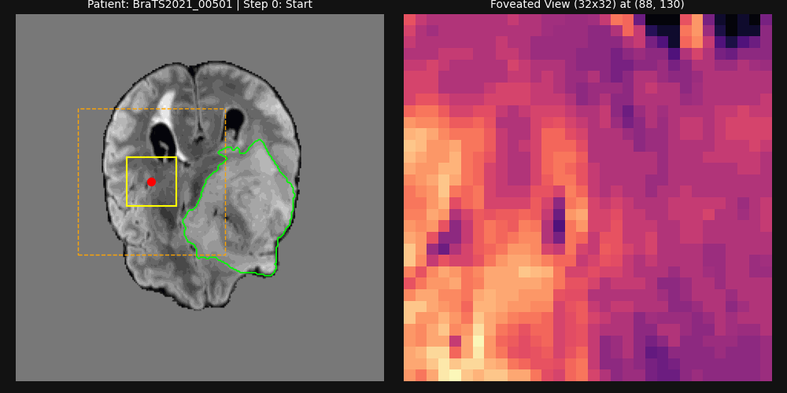
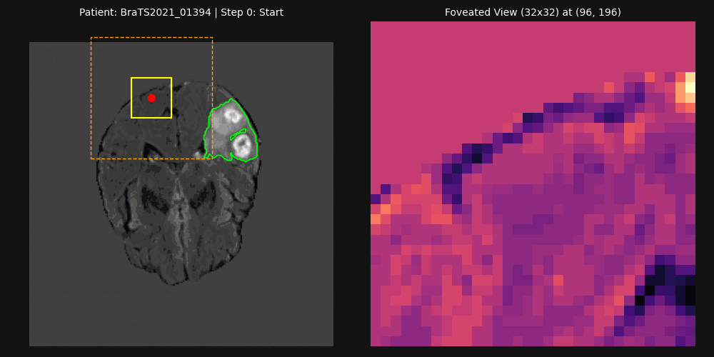

# Active-Vision Deep Reinforcement Learning for Brain Tumor Localization & ROI-Guided Segmentation

> **Note on Code & Reproducibility:** This repository contains the architectural implementation (`active_vision_core.py`), evaluation benchmarks (`.csv`), and visual demonstrations for our research manuscript (currently under peer review). While full training scripts and proprietary reward-shaping weights remain restricted pending publication, the core 12-channel Gymnasium environment specification and the complete Stage-2 Adaptive ROI Chan-Vese segmentation module are provided in [`active_vision_core.py`](./active_vision_core.py).

---

## 🎥 Autonomous Agent Demonstrations

### Case 1 (`BraTS2021_00008`): Long-Range Cross-Hemisphere Search & Fixation
*Starting far from the lesion in the opposite hemisphere, the agent leverages 10px macro-steps for rapid global traversal before executing terminal fixation inside the tumor core.*

### Case 2 (`BraTS2021_00501`): Large-Volume Tumor & Dynamic ROI Expansion (`64×64 → 96×96`)
*Demonstrates adaptive window scaling when encountering an extensive lesion where the initial 64×64 seed mask contacts the crop boundary.*

### Case 3 (`BraTS2021_01394`): Heterogeneous Multi-Focal Lesion & Boundary Adherence
*Illustrates robust localization and morphological contour evolution on a lower-contrast slice with complex, multi-core tumor morphology.*

- **Left Panel:** The PPO agent navigates the 240×240 multi-modal MRI slice using a multi-scale foveated observation window (yellow: 32×32 local high-acuity patch, orange: 96×96 intermediate context).
- **Right Panel:** Real-time 32×32 local foveated view tracking the agent's coordinates. Upon triggering the terminal fixation action (`Action 16`), the Stage-2 adaptive ROI-guided morphological Chan-Vese pipeline segments the lesion (**Green:** Ground Truth, **Red:** Predicted Mask).

---

## 🏗️ System Architecture & Core Contributions

Unlike dense pixel-wise CNNs that process the entire high-resolution volume indiscriminately, our framework decouples **spatial search (Stage 1)** from **boundary refinement (Stage 2)** using an active vision pipeline:

~~~mermaid
graph LR
    subgraph Input["12-Channel Multi-Scale Observation (32x32)"]
        A1["Local Patch (32x32) FLAIR, T1ce, T2 (3 ch)"]
        A2["Intermediate Context (96x96 -> 32x32) FLAIR, T1ce, T2 (3 ch)"]
        A3["Global Context (240x240 -> 32x32) FLAIR, T1ce, T2 (3 ch)"]
        A4["Spatial & Memory Maps Visited Map (0.98 decay) + Normalized X, Y (3 ch)"]
    end

    subgraph Agent["Stage 1: Deep RL Localization (PPO)"]
        B1["Custom Gymnasium Env (active_vision_core.py)"]
        B2["17-Action Discrete Space - 8 Macro Steps (10 px) - 8 Micro Steps (2 px) - 1 Terminal Trigger"]
    end

    subgraph Seg["Stage 2: Adaptive ROI Segmentation"]
        C1["Initial 64x64 ROI Crop around Fixation Point"]
        C2{"Boundary Contact Detected?"}
        C3["Expand to 96x96 ROI"]
        C4["Gaussian Smoothing + Flood Fill + Morphological Chan-Vese"]
    end

    A1 & A2 & A3 & A4 --> B1
    B1 --> B2
    B2 -->|"Action 0-15 (Next Step)"| B1
    B2 -->|"Action 16 (Fixation)"| C1
    C1 --> C2
    C2 -->|"Yes"| C3
    C2 -->|"No"| C4
    C3 --> C4
~~~

### Key Engineering Highlights
1. **Multi-Scale Foveated State Representation (`12 × 32 × 32`):** Combines high-acuity local patches (`32×32`), mid-range anatomical context (`96×96` downsampled via area interpolation), and global spatial awareness (`240×240` downsampled) across 3 MRI modalities (`FLAIR`, `T1ce`, `T2`), augmented with a decaying visitation memory map (`γ = 0.98`) and normalized spatial coordinates.
2. **Two-Scale Action Space & Stabilization (`Discrete(17)`):** Provides 8 coarse macro-actions (`10 px`) for rapid cross-hemisphere traversal, 8 fine micro-actions (`2 px`) for local adjustments, and an explicit stop/fixation trigger (`Action 16`). Step-size regularization near the lesion boundary mitigates overshoot oscillations and encourages prompt terminal fixation once the agent enters the target region.
3. **Adaptive ROI-Guided Morphological Chan-Vese:** Eliminates full-slice background false positives and reduces Stage-2 contour evolution time by restricting `cv2.floodFill` initialization and `morphological_chan_vese` refinement to a localized `64×64` window that dynamically expands to `96×96` upon detecting boundary contact.

---

## 📊 Quantitative Benchmarks & Evaluation Protocol

### Evaluation Protocol & Metrics Definition
- **Localization Success Criterion:** A patient episode is recorded as a successful localization if the agent's terminal fixation coordinate falls inside the ground-truth lesion mask or within a strict proximity threshold ($\le 5\text{ px}$ of the tumor boundary) prior to reaching the maximum step limit ($T_{\max} = 60$).
- **Stage-2 Segmentation Latency Measurement:** Latency metrics reported in the ablation tables specifically benchmark the **Stage-2 segmentation execution time** (post-localization contour refinement on a single-threaded CPU) across different ROI strategies against the full-slice (`240×240`) baseline under identical hardware conditions.

### 1. In-Distribution Evaluation: BraTS 2021 Internal Test Set ($N = 201$ Unseen Patients)
- **Stage-1 Localization Success Rate:** **96.02%** (`193 / 201` unseen patients successfully localized).

| Stage-2 Segmentation Strategy | Mean Dice | Mean Latency (ms) | Median Latency (ms) | P95 Latency (ms) | Stage-2 Speedup vs. Full |
| :--- | :---: | :---: | :---: | :---: | :---: |
| **Full Slice Baseline (`240×240`)** | 0.8337 | 64.7 ms | 63.7 ms | 72.0 ms | 1.0× (Baseline) |
| **Fixed ROI (`64×64`)** | 0.7622 | **7.8 ms** | **7.7 ms** | **8.4 ms** | **8.3×** |
| **Fixed ROI (`96×96`)** | **0.8401** | 13.2 ms | 13.1 ms | 14.1 ms | **4.9×** |
| **Adaptive ROI (`64→96`)** | 0.8399 | 20.4 ms | 20.6 ms | 22.1 ms | **3.2×** |
| *Oracle ROI (Ground Truth Center)* | *0.8662* | *11.5 ms* | *11.2 ms* | *17.7 ms* | *—* |

### 2. Zero-Shot Out-of-Distribution Generalization: BraTS 2023 Meningioma ($N = 1,000$ Patients)
Evaluated directly on 1,000 external Meningioma cases **without fine-tuning** to stress-test policy generalization under severe anatomical and contrast domain shift:
- **Zero-Shot Localization Success:** **70.60%** (`706 / 1,000` patients).
- **Adaptive ROI (`64→96`) Mean Dice:** **0.6571** at **18.1 ms** Stage-2 latency (outperforming Full-Slice segmentation both in boundary accuracy [`0.6419` Dice] and execution speed [`63.0 ms`]).
- **Failure Mode Analysis:** The ~25.4% drop in zero-shot localization compared to in-distribution glioma cases stems primarily from small, extra-axial meningiomas adjacent to the skull boundary with atypical T1ce/FLAIR intensity ratios, highlighting an active direction for domain-adaptive curriculum learning.

---

## 📂 Repository Structure
- `active_vision_core.py`: Modular Python implementation of the 12-channel `BrainTumorActiveVisionEnv` (Gymnasium) and `adaptive_roi_chan_vese` segmentation algorithm.
- `benchmarks_brats2021_id.csv` *(or `v19_ablation_internal.csv`)*: Raw patient-level ablation metrics on the unseen BraTS 2021 test split ($N=201$).
- `benchmarks_brats2023_ood.csv` *(or `v19_ablation_men.csv`)*: Raw zero-shot evaluation logs on the external BraTS 2023 Meningioma dataset ($N=1,000$).
- `agent_demo_*.gif`: Autonomous trajectory and segmentation visualizations across diverse tumor morphologies.

## 🛠️ Tech Stack
- **Core RL & Deep Learning:** `PyTorch`, `Stable-Baselines3 (PPO)`, `Gymnasium`
- **Computer Vision & Medical Imaging:** `OpenCV`, `scikit-image (Morphological Chan-Vese)`, `NiBabel`, `SciPy`
- **Parallelization:** `SubprocVecEnv` multiprocess sampling with single-threaded BLAS/OpenMP optimization
