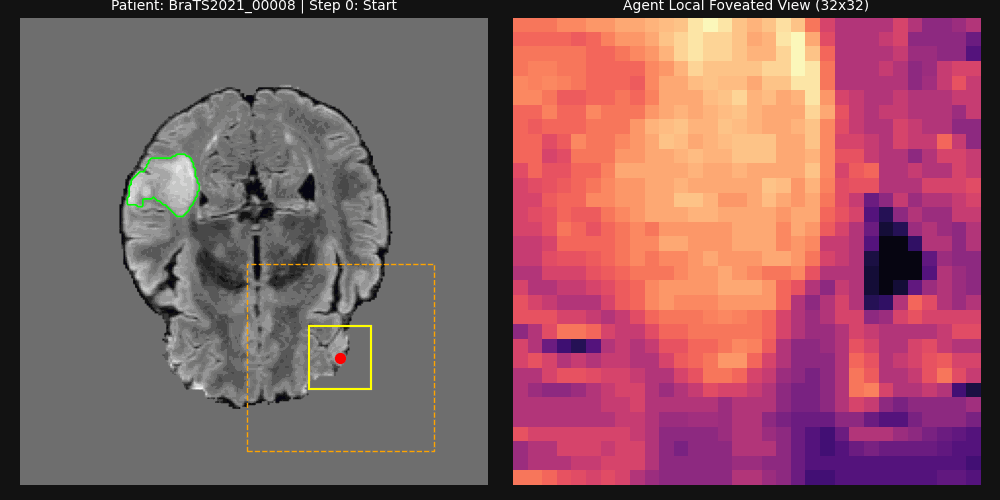
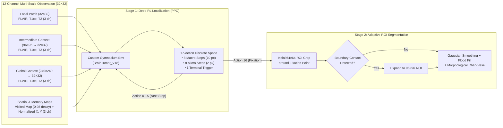

# Active-Vision Deep Reinforcement Learning for Brain Tumor Localization & ROI-Guided Segmentation

> **Note on Source Code Availability:** This repository serves as the official technical showcase, architecture reference, and benchmark release for our research manuscript (currently under peer review). While the full training pipeline remains restricted pending publication, the inference benchmark results, system architecture, and visual demonstrations are provided below.

---

## 🎥 Autonomous Agent Demonstration

* **Left Panel:** The PPO agent navigates the 240×240 multi-modal MRI slice using coarse macro-steps (10 px) for rapid global search and fine micro-steps (2 px) near the tumor boundary, utilizing a multi-scale foveated observation window (yellow: 32×32 local, orange: 96×96 intermediate).
* **Right Panel:** Upon triggering the terminal fixation action (`Action 16`), an adaptive ROI-guided morphological Chan-Vese pipeline segments the tumor in **~20.4 ms** (over **3.1× faster** than full-slice segmentation) while achieving superior boundary adherence (**Green:** Ground Truth, **Red:** Predicted Mask).

---

## 🏗️ System Architecture (12-Channel Multi-Scale Foveated RL + Adaptive ROI)

Unlike dense pixel-wise CNNs that process the entire high-resolution volume indiscriminately, our framework decouples **search** from **segmentation** using a two-stage active vision pipeline:

### Key Engineering Highlights
1. **Multi-Scale Foveated State Representation (`12 × 32 × 32`):** Combines high-acuity local patches (`32×32`), mid-range anatomical context (`96×96` downsampled via area interpolation), and global spatial awareness (`240×240` downsampled) across 3 MRI modalities (`FLAIR`, `T1ce`, `T2`), augmented with a decaying visitation memory map (`γ = 0.98`) and normalized spatial coordinates.
2. **Hierarchical Coarse-to-Fine Action Space (`Discrete(17)`):** Prevents premature convergence and oscillation by penalizing macro steps (`10 px`) within `15 px` of the lesion boundary, forcing the agent to transition to micro steps (`2 px`) before executing the terminal fixation trigger (`radius ≤ 5 px`).
3. **Adaptive ROI-Guided Morphological Chan-Vese:** Eliminates full-slice background false positives and reduces computational latency by restricting level-set evolution (`cv2.floodFill` initialization + `morphological_chan_vese`) to a localized `64×64` window that dynamically expands to `96×96` upon detecting boundary contact.

---

## 📊 Quantitative Benchmarks & Ablation Study

### 1. In-Distribution Evaluation: BraTS 2021 Internal Test Set ($N = 201$ Unseen Patients)
* **Localization Success Rate:** **96.02%** (`193 / 201` patients localized within the strict threshold).

| Segmentation Strategy | Mean Dice | Mean Latency (ms) | Median Latency (ms) | P95 Latency (ms) | Speedup vs. Full |
| :--- | :---: | :---: | :---: | :---: | :---: |
| **Full Slice (`240×240`)** | 0.8337 | 64.7 ms | 63.7 ms | 72.0 ms | 1.0× (Baseline) |
| **Fixed ROI (`64×64`)** | 0.7622 | **7.8 ms** | **7.7 ms** | **8.4 ms** | **8.3×** |
| **Fixed ROI (`96×96`)** | **0.8401** | 13.2 ms | 13.1 ms | 14.1 ms | **4.9×** |
| **Adaptive ROI (`64→96`)** | 0.8399 | 20.4 ms | 20.6 ms | 22.1 ms | **3.2×** |
| *Oracle ROI (Ground Truth)* | *0.8662* | *11.5 ms* | *11.2 ms* | *17.7 ms* | *—* |

### 2. Zero-Shot Out-of-Distribution Generalization: BraTS 2023 Meningioma ($N = 1,000$ Patients)
Evaluated directly on 1,000 external Meningioma cases without fine-tuning to test robustness under severe domain shift:
* **Zero-Shot Localization Success:** **70.60%** (`706 / 1,000` patients).
* **Adaptive ROI (`64→96`) Mean Dice:** **0.6571** at **18.1 ms** (outperforming Full-Slice segmentation both in accuracy [`0.6419` Dice] and speed [`63.0 ms`]).

---

## 🛠️ Tech Stack
* **Core RL & Deep Learning:** `PyTorch`, `Stable-Baselines3 (PPO)`, `Gymnasium`
* **Computer Vision & Medical Imaging:** `OpenCV`, `scikit-image (Morphological Chan-Vese)`, `NiBabel`, `SciPy`
* **Parallelization:** `SubprocVecEnv` multiprocess sampling with single-threaded BLAS/OpenMP optimization
